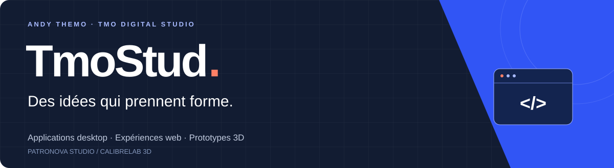
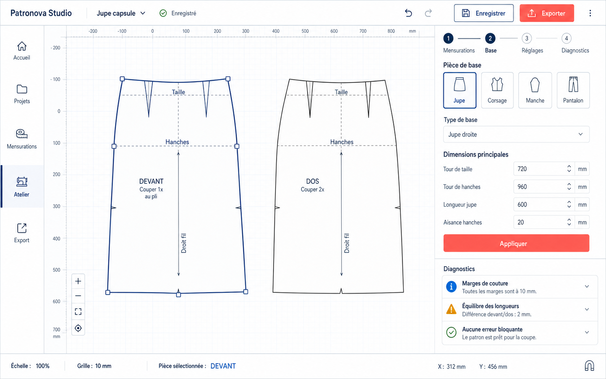
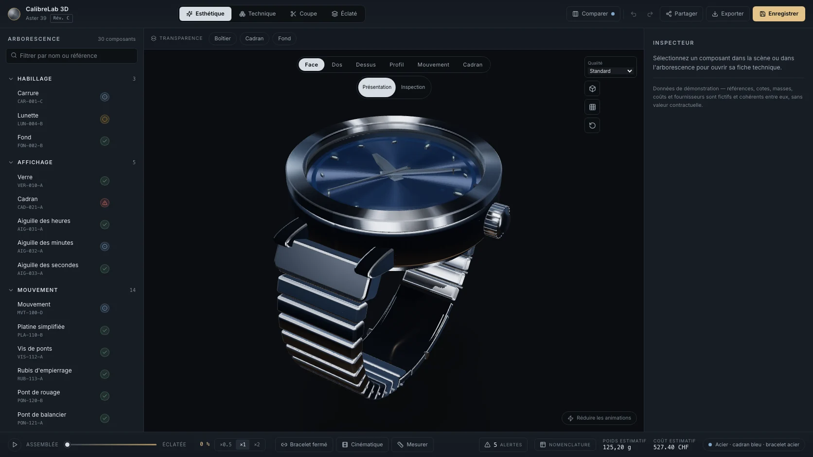
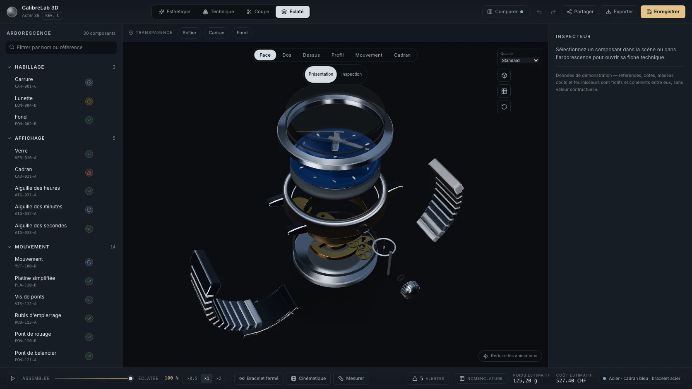
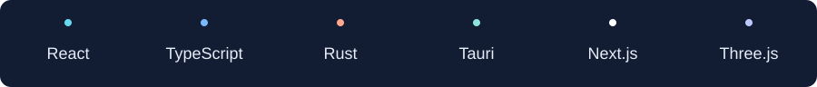

  

  <a href="https://tmodigitalstudio.com"><strong>TMO Digital Studio</strong></a>
  &nbsp; · &nbsp;
  <a href="mailto:contact@tmodigitalstudio.com">Me contacter</a>
  &nbsp; · &nbsp;
  <a href="https://www.linkedin.com/in/andy-themo/">LinkedIn</a>

<h2>Bonjour, moi c’est Andy.</h2>

Je conçois et développe des applications avec <strong>TMO Digital Studio</strong>, en Suisse romande. J’aime transformer une idée métier en une interface claire, un parcours concret et un outil que l’on peut prendre en main.

Mes deux projets personnels principaux : <strong>Patronova Studio</strong>, autour du patronnage vestimentaire, et <strong>CalibreLab 3D</strong>, autour de la conception horlogère.

<h2>Mes projets personnels</h2>

<h3>01 — Patronova Studio</h3>

<strong>Patronnage vestimentaire · Logiciel desktop · En développement</strong>

Un atelier numérique pour préparer des projets de patronnage à partir de profils de mensurations. Je travaille sur un logiciel local, avec une bibliothèque de projets, la sauvegarde des fichiers et la récupération des brouillons.

Maquette de conception de l’atelier cible. Le MVP actuel se concentre sur les projets, les mensurations et la persistance locale ; le dessin et les exports sont encore à développer.

<ul>
  <li><strong>Le besoin :</strong> garder le fil entre les mensurations, les projets et la préparation d’un patron.</li>
  <li><strong>Le travail en cours :</strong> construire les fondations du logiciel et faire évoluer l’atelier par étapes.</li>
  <li><strong>Mon rôle :</strong> conception du produit, design de l’interface et développement.</li>
  <li><strong>Technologies :</strong> Tauri, React, TypeScript et Rust.</li>
</ul>

<a href="mailto:contact@tmodigitalstudio.com?subject=Patronova%20Studio">Échanger sur Patronova Studio →</a>

<h3>02 — CalibreLab 3D</h3>

<strong>Conception horlogère · Application web 3D · Prototype interactif</strong>

Un atelier pour explorer les composants d’une montre en 3D : observer l’assemblage, passer à une vue éclatée, sélectionner une pièce et consulter ses informations dans un inspecteur.

Capture réelle du prototype. Modèle, références, mesures, coûts et fournisseurs de démonstration fictifs.

<ul>
  <li><strong>Le besoin :</strong> rendre un assemblage horloger complexe plus facile à explorer.</li>
  <li><strong>Dans le prototype :</strong> navigation 3D, sélection des pièces, vue éclatée, variantes et informations techniques de démonstration.</li>
  <li><strong>Mon rôle :</strong> conception du produit, design de l’atelier et développement du prototype.</li>
  <li><strong>Technologies :</strong> Next.js, React, TypeScript, Three.js, React Three Fiber et Zustand.</li>
</ul>

  
<strong>Voir la vue éclatée de CalibreLab 3D</strong>

  

  
Assemblage et sélection d’un composant — données fictives. Prototype de présentation ; il ne remplace pas un logiciel de CAO industriel ni une validation physique.

<a href="mailto:contact@tmodigitalstudio.com?subject=CalibreLab%203D">Échanger sur CalibreLab 3D →</a>

<h2>Du produit à l’interface</h2>

Comprendre le besoin, dessiner un parcours, construire un prototype, puis développer et vérifier les fonctions utiles. Ces deux projets me permettent d’explorer des univers différents : le vêtement et l’horlogerie.

<h2>Parlons de votre projet</h2>

Vous souhaitez échanger sur une application métier, un logiciel desktop ou une expérience 3D ?

<strong><a href="mailto:contact@tmodigitalstudio.com">contact@tmodigitalstudio.com</a></strong> 
<a href="https://tmodigitalstudio.com">tmodigitalstudio.com</a>

Les présentations portent sur mes projets personnels en développement. Leurs sources restent privées.

